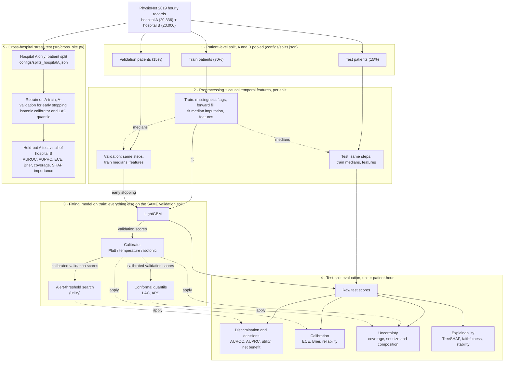
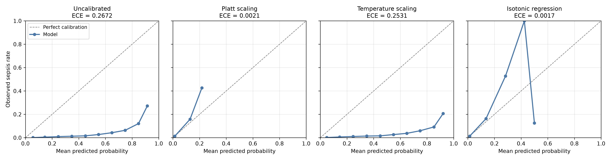
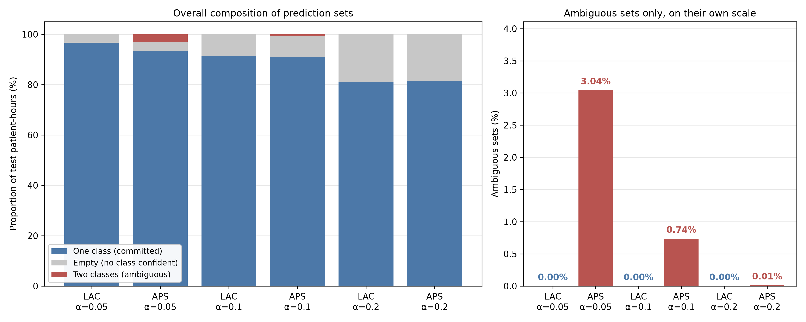

# Explainable Sepsis Prediction with Calibrated Uncertainty for ICU Time Series

**MSc research project** · MSc Machine Learning and Artificial Intelligence, 2025–26
**Author:** Shaidarov Daryn · **Supervisor:** Honghai Liu

This project predicts sepsis early, hour by hour, from ICU time series. It uses the
[PhysioNet/CinC Challenge 2019](https://physionet.org/content/challenge-2019/1.0.0/)
dataset: 40,336 ICU stays from two hospital systems, with one row of vitals, labs and
demographics per patient-hour. For every hour, the model estimates the probability that the
hour's `SepsisLabel` is positive. The label is shifted six hours ahead of estimated onset.

The project fixes one LightGBM model and studies what surrounds it: calibrated
probabilities, uncertainty sets, explanation quality and transfer to another hospital. It
is retrospective research code and has not been clinically validated.

## Research questions

1. **Calibration:** How miscalibrated is a class-reweighted LightGBM? Which method corrects
   it: Platt, temperature or isotonic?
2. **Uncertainty:** How do split-conformal LAC and APS sets behave when about 2% of hours
   are positive?
3. **Explanations:** Are TreeSHAP attributions faithful (deletion/insertion against a
   random ordering) and stable across consecutive hours?
4. **Transfer:** When trained on hospital A, how do discrimination, calibration, coverage
   and feature importance change on hospital B?

## Methods

| Component | Implementation |
|---|---|
| Splits | Patient-level 70/15/15 split, stratified by sepsis status, with A and B pooled ([`configs/splits.json`](configs/splits.json)). Random, not temporal. |
| Preprocessing | Missingness flags. Within-patient forward fill (vitals 8 h, labs 24 h). Medians fitted on train only. |
| Features | Backward-looking 6 h and 24 h rolling stats and 6 h trends for HR, SBP, MAP, Resp and Temp. Shock index. All raw columns. |
| Model | LightGBM, `is_unbalance: true`, early stopping on validation AUROC ([`configs/lightgbm.yaml`](configs/lightgbm.yaml)). |
| Calibration | Platt, temperature, isotonic, each fitted on validation predictions. |
| Conformal | LAC and randomised APS. Quantile from calibrated validation scores, α ∈ {0.05, 0.10, 0.20}. |
| Explainability | TreeSHAP on the raw booster. Deletion/insertion AUC compared with a random ordering. Consecutive-hour stability. |
| Decision analysis | Challenge-style utility (not the official scorer), threshold tuned on validation, decision curves. |
| Cross-hospital | Retrain on hospital-A patients ([`configs/splits_hospitalA.json`](configs/splits_hospitalA.json)). Test on the held-out A patients and all of hospital B, with no refitting on B. |

## Research pipeline



One validation split is used for early stopping, calibration, the conformal quantile and
threshold selection. Test data is never used for fitting.

## Results

There is no saved results log. The scripts print metrics to the console, and the trained
model is not committed. The figures below were generated from the local model on the
pooled test split (6,051 patients). The evaluation unit is the patient-hour, and 1.79% of
test hours are positive. No artifact records a pooled-test AUROC.

**Calibration.** Test ECE (10 equal-width bins) is 0.267 for raw scores, 0.002 after Platt,
0.253 after temperature scaling and 0.002 after isotonic regression. Class reweighting
inflates the raw scores, and temperature scaling has no intercept to correct this.


*Figure 1. Test-split reliability, raw and with each calibrator fitted on validation.*

**Conformal sets.** LAC never produces a two-label set; it returns empty sets instead. APS
produces two-label sets for 3.04%, 0.74% and 0.01% of test hours at α = 0.05, 0.10 and
0.20. Coverage is printed to the console but not saved. Class-conditional coverage is not
computed.


*Figure 2. LAC and APS set composition on test patient-hours (isotonic calibration).*

**Cross-hospital.** These values are constants transcribed from the dissertation into
[`src/demo/make_figures.py`](src/demo/make_figures.py). They were not regenerated from a
saved run. Calibration is isotonic, fitted on hospital-A validation. Coverage is for LAC at
α = 0.10.

| Metric | Hospital A, held-out (3,051 patients) | Hospital B (20,000 patients) |
|---|---|---|
| AUROC | 0.826 | 0.747 |
| AUPRC | 0.121 | 0.063 |
| ECE after calibration | 0.0005 | 0.0035 |
| Empirical coverage (target 0.90) | 0.898 | 0.935 |

Higher coverage on B is not evidence of robustness: the conformal assumptions do not hold
across sites.

[`outputs/demo/index.html`](outputs/demo/index.html) is an **illustrative** dashboard for
four selected test patients, not an evaluation. The provenance of each figure is listed in
[`docs/evaluation-notes.md`](docs/evaluation-notes.md).

## Reproduction

Python 3.14 was used. [`requirements.txt`](requirements.txt) is unpinned; the frozen
environment is in [`appendix_d_versions.txt`](appendix_d_versions.txt).

```powershell
python -m venv .venv
.\.venv\Scripts\Activate.ps1
pip install -r requirements.txt
# Put the data in data\raw\training_setA and data\raw\training_setB (see data/README.md)
python -m src.train                          # writes outputs/lightgbm_baseline.txt (+ .features.json)
python -m src.calibrate --method isotonic
python -m src.quantify_uncertainty
python -m src.explain
python -m src.decision_curve_analysis
python -m src.cross_site                     # retrains its own hospital-A model
python -m src.demo.make_figures --all
python -m pytest                             # unit tests on synthetic inputs
```

Neither the data nor the trained model is in the repository. Every script after
`src.train` needs the model file. For details see
[`docs/reproduction.md`](docs/reproduction.md).

## Evaluation and limitations

- **Class imbalance:** AUROC alone is optimistic, and a low ECE mostly reflects
  near-zero predictions.
- **Patient-hour dependence:** correlated hours are pooled, and there are no patient-level
  confidence intervals. Hours are not exchangeable, so conformal coverage is not
  guaranteed.
- **Validation reuse:** conformal scores come from the same points used to fit the
  calibrator. Treat coverage as empirical.
- **Patient-level is not temporal validation:** test patients share hospitals and period
  with the training patients.
- **Cross-site shift:** only two sites are public. Site-related features (`Unit1`, `Unit2`,
  `HospAdmTime`, `ICULOS`) rank highly.
- **Utility score:** the score in [`src/evaluation/metrics.py`](src/evaluation/metrics.py)
  handles early alarms and post-onset hours differently from the official scorer. It is not
  comparable with Challenge results.
- **Explanations:** deletion sets features to NaN, which the model rarely sees. SHAP
  explains uncalibrated log-odds.
- **Retrospective only:** there is no prospective or clinical evaluation.

See [`docs/evaluation-notes.md`](docs/evaluation-notes.md) for details.

## Code map

| Path | Role |
|---|---|
| [`src/data/`](src/data/) | Loading, splits, preprocessing, features |
| [`src/models/`](src/models/) | Model interface, LightGBM wrapper |
| [`src/calibration/`](src/calibration/) | Platt, temperature, isotonic |
| [`src/uncertainty/`](src/uncertainty/) | LAC ([`conformal.py`](src/uncertainty/conformal.py)), APS ([`aps.py`](src/uncertainty/aps.py)) |
| [`src/explainability/`](src/explainability/), [`src/evaluation/`](src/evaluation/) | SHAP; metrics, faithfulness, stability, decision curves |
| [`src/`](src/) `train.py`, `calibrate.py`, `quantify_uncertainty.py`, `explain.py`, `decision_curve_analysis.py`, `cross_site.py` | Experiment entry points |
| [`src/demo/`](src/demo/) | Figure scripts, illustrative dashboard |
| [`tests/`](tests/) | pytest unit tests |

## Dataset, citation and licence

The data is PhysioNet/CinC Challenge 2019 v1.0.0, listed as "Challenge Open Access". Check
the licence on the [dataset page](https://physionet.org/content/challenge-2019/1.0.0/). The
data is not redistributed here. PhysioNet asks users to cite the dataset
([doi:10.13026/v64v-d857](https://doi.org/10.13026/v64v-d857)) and Reyna et al., *Critical
Care Medicine* 48(2):210–217 ([doi:10.1097/CCM.0000000000004145](https://doi.org/10.1097/CCM.0000000000004145)).

Ethical review arrangements are not documented in this repository. The dissertation is not
included, and there is no software licence file, so default copyright applies.
